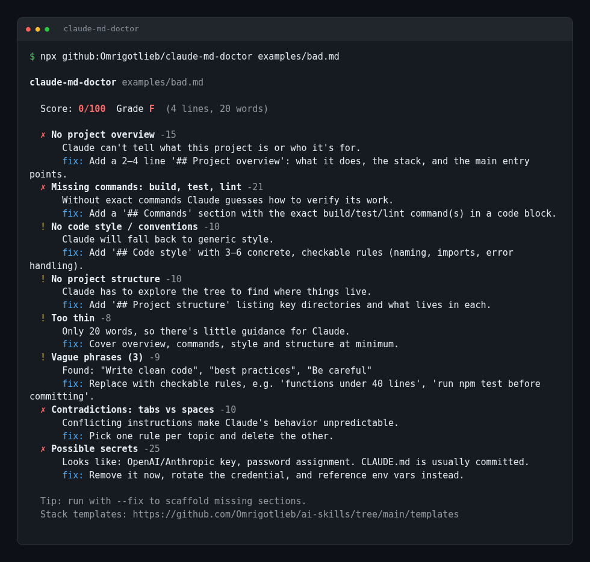

# claude-md-doctor

**Lint and score your `CLAUDE.md` out of 100, with a concrete fix for every problem.**
One command, no API key, no network: catches missing build/test commands, vague rules, contradictions, bloat and leaked secrets.



[](LICENSE)

`CLAUDE.md` is loaded into every Claude Code session, so a vague, bloated or contradictory one makes every session worse.

## Install & run

```bash
npx github:Omrigotlieb/claude-md-doctor            # checks ./CLAUDE.md
npx github:Omrigotlieb/claude-md-doctor path/to/CLAUDE.md
```

> Coming soon on npm as `npx claude-md-doctor`.

Flags:

| Flag | What it does |
|---|---|
| `--fix` | Appends missing sections (overview, commands, code style, structure) as TODO scaffolds |
| `--json` | Machine-readable report |
| `--min <n>` | Exit 1 if the score is below `n` (use it in CI) |

## Example output

```text
$ npx github:Omrigotlieb/claude-md-doctor examples/bad.md
claude-md-doctor examples/bad.md

  Score: 0/100  Grade F  (4 lines, 20 words)

  ✗ No project overview -15
      Claude can't tell what this project is or who it's for.
      fix: Add a 2–4 line '## Project overview': what it does, the stack, and the main entry points.
  ✗ Missing commands: build, test, lint -21
      Without exact commands Claude guesses how to verify its work.
      fix: Add a '## Commands' section with the exact build/test/lint command(s) in a code block.
  ! No code style / conventions -10
      Claude will fall back to generic style.
      fix: Add '## Code style' with 3–6 concrete, checkable rules (naming, imports, error handling).
  ! No project structure -10
      Claude has to explore the tree to find where things live.
      fix: Add '## Project structure' listing key directories and what lives in each.
  ! Too thin -8
      Only 20 words, so there's little guidance for Claude.
      fix: Cover overview, commands, style and structure at minimum.
  ! Vague phrases (3) -9
      Found: "Write clean code", "best practices", "Be careful"
      fix: Replace with checkable rules, e.g. 'functions under 40 lines', 'run npm test before committing'.
  ✗ Contradictions: tabs vs spaces -10
      Conflicting instructions make Claude's behavior unpredictable.
      fix: Pick one rule per topic and delete the other.
  ✗ Possible secrets -25
      Looks like: OpenAI/Anthropic key, password assignment. CLAUDE.md is usually committed.
      fix: Remove it now, rotate the credential, and reference env vars instead.

  Tip: run with --fix to scaffold missing sections.
  Stack templates: https://github.com/Omrigotlieb/ai-skills/tree/main/templates
```

## What it checks

| Rule | Penalty |
|---|---|
| Project overview present | 15 |
| Build / test / lint commands (7 each) | up to 21 |
| Code style / conventions section | 10 |
| Project structure | 10 |
| Length: too thin (<40 words), long (>200 lines), bloated (>400 lines) | 8 / 7 / 15 |
| Vague phrases ("best practices", "be careful", "as needed"…) | 3 each, up to 12 |
| Contradictions (tabs vs spaces, npm vs pnpm, quotes, semicolons, default exports…) | 10 each, up to 20 |
| Secrets (API keys, GitHub/Slack tokens, private keys, password assignments) | 25 |

Score = 100 minus penalties. Grades: A ≥ 90, B ≥ 80, C ≥ 70, D ≥ 60.

## Use in CI

```yaml
- run: npx github:Omrigotlieb/claude-md-doctor CLAUDE.md --min 80
```

## Programmatic

```ts
import { analyze } from "claude-md-doctor";
const report = analyze(text); // { score, grade, findings, passed, lines, words }
```

## More from me

- [founder-deck-skill](https://github.com/Omrigotlieb/founder-deck-skill): founder notes → HTML pitch deck (agent skill)
- [mcp-solo-founder](https://github.com/Omrigotlieb/mcp-solo-founder): MCP server for running a one-person company
- [awesome-claude-skills-gallery](https://github.com/Omrigotlieb/awesome-claude-skills-gallery): see what agent skills produce before installing
- [ai-skills](https://github.com/Omrigotlieb/ai-skills): CLAUDE.md templates, skills, MCP servers and hooks
- [awesome-anthropic](https://github.com/Omrigotlieb/awesome-anthropic): daily-updated Anthropic / Claude resources

If this is useful, a ⭐ helps other people find it.

## Contributing

New rules are welcome. Add one in `src/rules.ts` with a test in `test/`, then run `npm test`.

MIT © Omri Gotlieb
